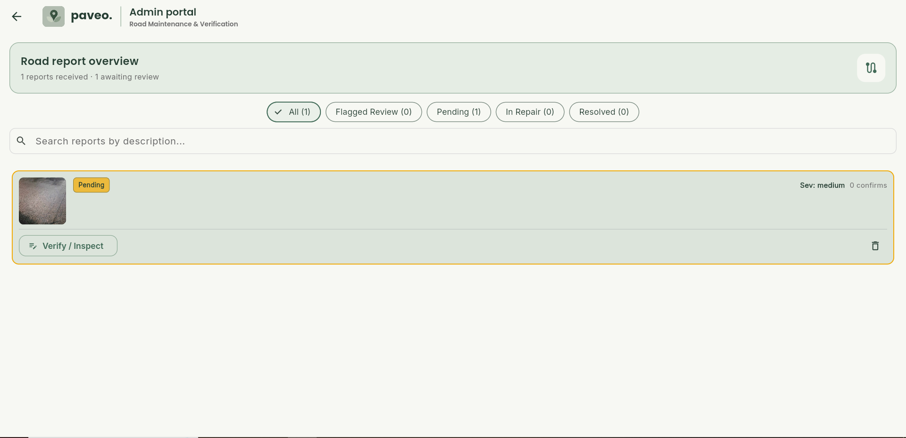
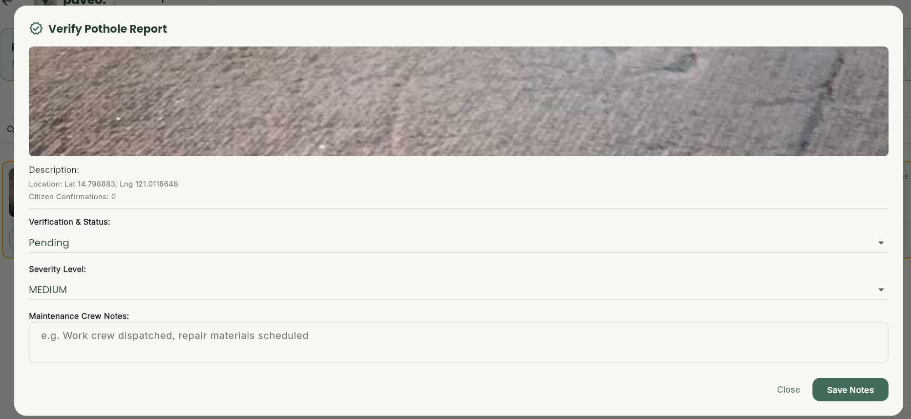
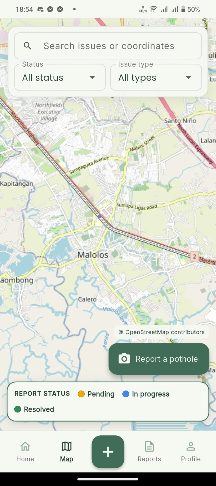

# 06 — Interface screenshots

Screenshots provided for the Week 2 submission:

## Website home

## Admin portal

## Admin pending report

## Admin verify and inspect

## Resident map

**Still needed:** resident mobile home and report flow, plus a submitted-report confirmation or tracking screen. Use test data and hide personal details before adding them.
